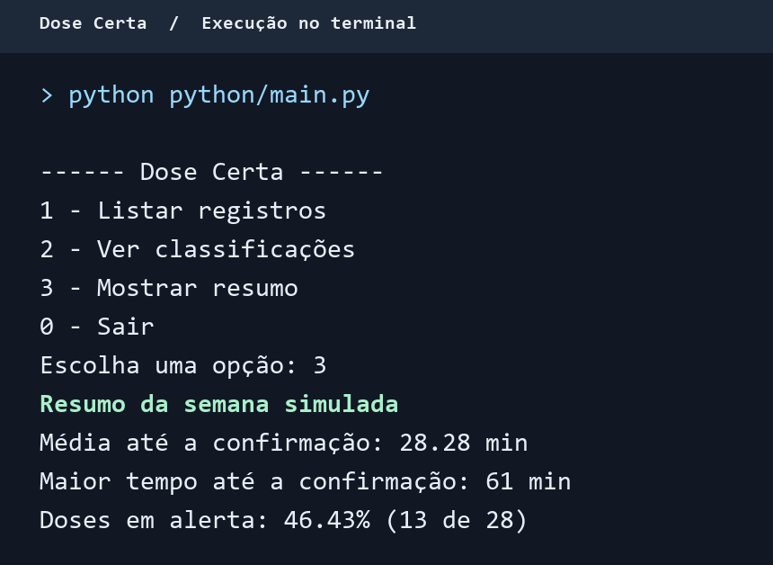

# Dose Certa — Python

**FIAP · Global Solution 2026.2 · Computational Thinking with Python**

O Dose Certa simula uma semana de registros de um porta-comprimidos inteligente. O programa classifica as 28 doses simuladas de acordo com o tempo até a confirmação e mostra um resumo da semana.

## Como executar

Tenha o Python 3 instalado. O programa usa apenas recursos padrão do Python.

No terminal, a partir da raiz do repositório, execute:

```bash
python python/main.py
```

No Windows, se o comando `python` não estiver disponível, use `py -3 python/main.py`.

Digite o número de uma opção e pressione **Enter**.

| Opção | O que faz |
| --- | --- |
| `1` | Lista os registros da semana e o tempo até a confirmação de cada dose. |
| `2` | Mostra a classificação de cada dose. |
| `3` | Exibe a média, o maior tempo até a confirmação e o percentual de doses em alerta. |
| `0` | Encerra o programa. |

Se a opção for inválida, o programa exibe um aviso e volta ao menu.

## Classificação das doses

| Tempo até a confirmação | Classificação |
| --- | --- |
| De 0 a 30 minutos | Confirmada no prazo |
| De 31 a 60 minutos | Atrasada |
| Acima de 60 minutos ou sem confirmação | Perdida |

A média e o maior tempo usam os registros com um tempo de confirmação informado. O percentual de alertas divide a quantidade de doses atrasadas ou perdidas pelo total de doses simuladas.

## Execução

A opção `3` mostra o resumo da semana simulada.


